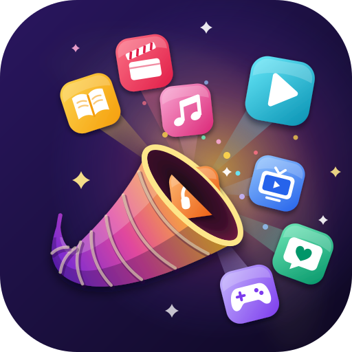

# MediaCopia



A single-page browser app for everything you read, hear, watch, play and follow: **books, music, movies, gaming, TV, streaming and social media**.

1. **Organize**: one library for all seven media types, with per-type statuses (Want to read / Playing / Watched…), 5-star ratings, tags, notes, links and release dates.
2. **Recommend**: a tri-state interest checklist (like ♥ / love ♥♥ / avoid ✕) across genres, platforms, services and moods, a "Your own" box in every category for specific interests (a series, a niche, a person), plus your own words and favourite creators. Two recommendation engines:
   - **For you (offline)** scores a built-in catalog of ~110 well-known titles, services and communities against your checklist, ratings and favourite creators. It needs no key and shows why each pick was made.
   - **✨ Ask (Claude)** answers open-ended requests ("a funny show under 30 minutes", "albums like Rumours") using your whole profile. It can search the web for anything current.
3. **Calendar of drops**: one section per month listing only the days that have releases, each with a large date badge and big cover-art cards. Month chips jump between months, and past drops can be shown or hidden. Sources are drops you add, library items with a release date, and **✨ Find upcoming drops**, which has Claude search the web for releases that match your interests and creators. You can export everything to `.ics` for Apple/Google Calendar.

**Ask anything re your interests.** The ✨ Ask bar in the header follows the media type you picked: "a short sci-fi novel" with Books selected, or "when is the next Dune book?" on the Calendar, where it searches upcoming drops. The last search on each page stays there until you clear it. Calendar answers list dates you can add one at a time or all together.

**Where to get it.** Every recommendation and drop shows how to watch, listen, read, play or follow it. With a key, Claude names the actual services, stores, sites and channels for your country, puts the services you already use first, and labels each one subscription, free, rent, buy, library, theaters, broadcast or cable (a cable or satellite channel, live, on demand or in the network's app). Every card also has search links such as JustWatch, Spotify, Libby, Goodreads, Steam and the PlayStation Store. You can set your country in Settings.

**My subscriptions.** In Settings you pick from about 55 services, shown as app-style logo tiles with a price under each, across Movies & TV, Cable & satellite TV, Music, Books & audiobooks, Library card, Free with ads, Gaming, and Social & creators. The Cable & satellite TV group lists the providers for your country (Xfinity, Spectrum, DIRECTV, DISH, Fios, Cox, Optimum and others in the US; Sky and Virgin Media in the UK; Rogers, Bell Fibe and Vidéotron in Canada; Foxtel in Australia). Tick yours and anything on cable channels counts as yours: "✓ Yours · FX, with your Xfinity TV package". The built-in prices are approximate US list prices. **💲 Check prices & deals** has Claude search the web for current prices, plans, discounts and free trials in your country. Services with an offer get a DEAL or TRIAL flag and appear in a "Deals & free trials right now" list with links. Where-to-watch lists in the details popup use the same logo tiles, labelled like "Subs 4K", "Free" or "$3.99 Rent". Every recommendation and drop then shows "✓ On your subscriptions" with a direct link, or "Not on your subscriptions" followed by other options. Without a Claude answer, a card shows "Check your subscriptions", which searches your relevant services for that title.

**Covers, posters and logos.** Every title in the app has a thumbnail: library cards, recommendations, Claude's answers, drops, the calendar (large cards) and Discover history. Real covers are looked up by title from Open Library (books), TVMaze (TV), Wikipedia (films, games, albums, artists, creators) and Apple's iTunes Search (as a fallback). Services and platforms get their logos. Until an image is found, or when nothing is found, a title shows generated cover art in its media type's colours. Each media category has its own artwork on the Home tiles, the Library banner (with a shelf of your recent covers) and the Interests headings. Lookups are cached in the browser. You can set your own image on any library item, or turn lookups off in Settings → Appearance. Only titles and site names are sent.

**Cinematic cards.** Every library item, recommendation and drop is a 16:9 card with its artwork filling it. Wide art (such as TV backdrops from TVMaze) fills the frame. Posters, book covers and album art are shown whole on a blurred, darkened copy of themselves, so nothing is cropped. Click a pick or drop for a details popup with the full reasons, every place to get it, and the buttons.

**Trailers and clips, Netflix style.** Hover a card and it grows into a preview: the trailer plays muted, with ▶ (full player with sound), ＋ (add to your list), 👍 (already did), ⌄ (details), its tags, and a "Watch on Netflix" (or Spotify, Apple TV+…) button when it's on one of your subscriptions. On touch screens, tap ▶ on a card. Clips come from, in order: the trailer link on the title (Claude's, or one you paste on a library item); the official YouTube trailers listed on Wikidata; trailers Claude found with web search; and Apple previews (TV episode clips, 30-second song previews, audiobook samples). Every YouTube link is checked with YouTube before it's used. Deleted or private videos, and "YouTube Movies" listings of a whole film, are skipped and the next source is tried. Videos a studio only allows on YouTube get a "Watch on YouTube" link, which opens the YouTube app on phones. The player names the video and channel, always has an "Open in YouTube" link, and lists any working backups. If nothing is found, **✨ Find with Claude** searches the web for official trailers. It never uses fan-made videos, and it says so when only a previous season's trailer exists. The working link is saved on the drop or library item. On the Calendar, **🎬 Check trailers** does this for every upcoming release you're showing and reports which ones still have no trailer.

**📺 How to watch, cheapest way first.** This uses HyperFan's "cheapest legal path" method. Every card shows the cheapest way to get it as a chip: "✓ Yours · Netflix", "Free · Libby", "$3.99 · Apple TV". It's green when it's free to you, blue for a free trial, and amber when you'd pay. Every film and TV card also has a How to watch button. Its popup and the details popup show the cheapest way as a big chip, then every other option ranked: your subscriptions, then free ones (with ads, a library card, or a broadcast channel you can get with an antenna), then paid ones by real price, so a $3.99 rental beats a new $8.99/mo subscription. Free trials are ranked by what they cost afterwards. Each option is tagged YOURS, FREE, LIBRARY, TRIAL, SUBS, ADD-ON, RENT, BUY, CINEMAS or ON TV. Subscription prices and trials come from Check prices & deals when Claude didn't give one. JustWatch search links are at the bottom. **✨ Check with Claude** looks up live options for your country in a few seconds and saves them on the title, so its card shows where to watch too. A paid channel inside a service you have (Paramount+ through Prime Video) is shown as an add-on, not as yours.

**Watchlist.** A Watchlist link in the sidebar, with a count, opens everything you've put on your list: library items marked Watchlist, Want to read, Want to hear, Backlog, Considering or Interested. It's grouped by media type, newest first, and follows the category tiles. **+ Watchlist** on any recommendation adds to it.

**📡 On Live TV Now.** Pick the TV tile on Home and a live program guide appears at the top. Your TV provider (ticked in Settings → Cable & satellite TV, or picked right in the guide) frames it. "On now" cards show what's airing this minute with a progress bar. Below them is a channel-by-time grid for the next three hours, with ◀ Earlier / Now / Later ▶ up to a day ahead. Channels showing something in your library come first, starred. Shows in your favourite TV genres get an orange edge. Cable channels are marked "✓ yours" and broadcast networks "antenna". Click a show for details, How to watch and + Want to watch. Listings come from TVmaze's free schedule for your country (series episodes, so some movies, news and sports are missing). The guide links to your provider's full guide and its watch app.

**The full guide (✨ Get every channel).** With your own [Schedules Direct](https://www.schedulesdirect.org) account (a nonprofit guide-data service, about $35 a year, with a free 7-day trial), the guide becomes your real cable or satellite lineup for your ZIP code: every channel with its channel number, and every program (movies, news and sports too), about two weeks ahead. Click **Get every channel ✨**, sign in with your Schedules Direct username and password, enter your ZIP code and pick your lineup (Spectrum lineups are listed first if Spectrum is your provider). A search box finds a channel or show among hundreds. Titles load for what's on screen as you scroll. Your password is SHA-1 hashed in the browser before it is sent, as their API requires. The hash, username, ZIP code and lineup are kept in your encrypted settings and synced, never written into a backup file. Their API can't be called from a web page directly, so requests pass through a relay at mediacopia.com/sd/ that stores nothing (see `server/sd-relay.nginx.conf`). **Turn off** forgets it all. Schedules Direct licenses its data for individual use in open-source software, which is why MediaCopia is open source.

**AI usage on this device.** Settings shows what each Claude feature costs: for Ask, Recommend, How to watch, Find upcoming drops, price checks and trailer searches, how many times you've used it, the average cost, tokens in and out, web searches and time, split by model. It adds up the token and web-search counts Claude reports on every answer and prices them at Anthropic's list prices (November 2026: Opus 5.5 $4 / $20 per million input / output tokens, Sonnet 5.5 $2 / $10, Haiku 5.5 $0.10 / $0.50, web searches $10 per 1,000). Fast mode's surcharge isn't included, so those rows are marked ⚡. The log stays on the device (it isn't synced), can be downloaded as CSV, and can be reset. Your Anthropic console has the exact bill.

**★ Recommend.** A big button in the header next to the Ask bar. It gets personal picks for the media type you picked, using your interests, subscriptions, ratings and library, with no typing. On the Calendar it finds upcoming releases you'd love. While it works, a clock shows how long the search has taken, and picks appear one by one as Claude writes them instead of all at the end. Without a key it uses the offline engine.

**Category tiles** sit in the header on every page: All, Books, Music, Movies, Gaming, TV, Streaming and Social Media. Each shows how many interests you've ticked for it (including your own), plus your subscriptions and saved items. Clicking a tile filters the page you're on. At the top of the Interests page, a "Your Books" (or Music…) panel sums up what you've ticked for that type and your subscriptions for it. With All picked, the panel lists every interest grouped by category, plus all your subscriptions.

**One header for every page.** A sticky header sits at the top of every page, and pages scroll under it while the sidebar stays put. At the top is the hero banner: the cornucopia logo (as wide as a category tile), the **MediaCopia** wordmark and the tagline *My Media My Way*, set in the Google Fonts Rammetto One and Josefin Sans. Below that are the category tiles, the dark/light switch, the ✨ Ask bar with ★ Recommend, and that page's buttons (Add, Quick add list, Export .ics, Find upcoming drops, the Discover tabs). The type you pick filters every page: Home, Library, Interests, Discover, Calendar and the subscription list in Settings. Ask results appear right under the header. On a phone the tiles scroll sideways and the page buttons sit under each page title.

## Run it

No build step and no dependencies. Open `index.html` in a browser, or serve the folder:

```bash
python3 -m http.server 5173
```

then visit http://127.0.0.1:5173. Opening http://localhost:5173 switches to 127.0.0.1 automatically, because browsers store data separately for the two addresses.

### Hosting your own copy

MediaCopia is static files: put `index.html`, `css/`, `js/` and `assets/` on any web server with HTTPS. Two settings in `js/sync-config.js` point at mediacopia.com's services, and a copy on another domain needs its own:

- **Sync** (`MC.SYNC_URL`, `MC.SYNC_KEY`): a Supabase project with the `mc_records` and `mc_keyring` tables described under Lock and sync. Without one, everything else works and sync stays off.
- **Full TV guide** (`MC.SD_RELAY`): the relay in `server/sd-relay.nginx.conf`, on your server. mediacopia.com's relay only answers mediacopia.com.

## AI setup (optional)

Settings → paste an Anthropic API key from [console.anthropic.com](https://console.anthropic.com/settings/keys) → **Test**.

- Default model: `claude-opus-5-5`. You can switch to Sonnet 5.5 or Haiku 5.5 in Settings.
- The official Anthropic JS SDK (`@anthropic-ai/sdk`) is loaded on demand from esm.sh, with jsDelivr as a fallback, and it calls `api.anthropic.com` directly from the browser.
- The key is stored only in this browser's localStorage. Backups exclude it.
- **Speed.** Ask answers a question first, in a few sentences, and adds only the titles the answer is about. It uses low effort, the plain web search (no filtering step, at most 3 searches) and Opus fast mode where your key has it. Fast mode is billed at about twice the normal rate, but these answers are short. ★ Recommend uses the same settings and still gives 6–10 picks. Timed on "will there be a new season of Mobland?": 58s before, about 4s now. ★ Recommend went from 58s to about 7s, with the first pick on screen in under 3s.
- Web search can be switched off in Settings. Usage is billed to your Anthropic account.

## Lock and sync (encrypted, the same as CatchAll)

MediaCopia works exactly like CatchAll's encryption and sync:

- **Locked with your passphrase.** The first time you open it, you choose a passphrase. Everything (library, watchlist, interests, calendar, saved asks, settings and your Claude key) is then encrypted in this browser with AES-256-GCM, including data you already had. The data key is locked by your passphrase (PBKDF2, 600,000 rounds), and nothing readable is left in browser storage. There's a strength meter. There is no reset: the passphrase can't be recovered, and "Forgot passphrase?" only erases this device's copy.
- **Each time you open it,** enter the passphrase, unless you ticked **Remember on this device**, which keeps the key sealed with a key the browser can't export. MediaCopia **locks automatically** after 5, 15 (the default) or 60 idle minutes, or never. Auto-lock is off while the device is remembered. **Lock** in the sidebar or Settings drops the key and your data from memory. Wrong guesses are slowed down.
- **Sync** (the ☁️ button in the header): sign in with a code emailed to you. The dot shows the status: green synced, blue syncing, amber offline or waiting for a passphrase, red signed out or a problem. Records are encrypted with the same key before upload, so the server stores only ciphertext, plus ids, times and deleted flags.
- **Another device:** on its first screen choose **Use my MediaCopia from another device**, sign in, then enter your passphrase. If a device already has its own passphrase and data, signing in asks once for the synced passphrase and **merges** its data in. **Change passphrase** in Settings reaches your other devices: they use the new one next time they unlock.

Data is split into records (each library item, drop and saved ask; your interests; your own interests per category; settings; prices) so edits on two devices merge. If the same record changes on two devices, the newest edit wins, and the server enforces that too. Deleting something marks it deleted so every device removes it. Your Claude key and the cover and trailer caches are never synced.

Supabase tables: `mc_records` and `mc_keyring`, in MediaCopia's own Supabase project ("MediaCopia", us-east-1), with row-level security so each account sees only its own rows (migration `mediacopia_sync_schema`). Code: `js/crypto.js` (ported from CatchAll), `js/vault.js` (encrypted storage), `js/lock.js` (lock screen, auto-lock and the sync dialogs), `js/sync.js` (push and pull), `js/sync-config.js` (the project's address and publishable key).

## Data

Everything is stored encrypted in this browser's IndexedDB (database `mediacopia`), and optionally syncs encrypted across your devices (above). Older versions kept it in plain text in `localStorage` (`mediacopia.v1`); it's encrypted and removed the first time you choose a passphrase. Settings → **Export backup** saves a JSON file.

**Import & share** (`#/share`, in the sidebar; **Share** on Library, Watchlist and Calendar; **Share** in an item's editor):
- **Share a list**: your watchlist, library or upcoming releases (following the category chosen at the top) as a link. The list is compressed into the part of the link after `#`, which browsers never send to a server, so it goes straight from you to whoever opens it. Ratings are included unless you untick them; notes only if you tick them. Opening a link (`#/shared/…`) shows the list (a short preview on the lock screen first), and **+ Add** puts titles on your own watchlist with "Shared by …" in the notes. Long lists can be sent as a file instead.
- **Export**: each list as a spreadsheet (.csv), MediaCopia list (.json) or text, the calendar also as .ics, and the full backup (without the Claude key).
- **Import**: a MediaCopia backup or list, Goodreads, Letterboxd and IMDb CSV exports, any spreadsheet with a title column, or a pasted list (one per line, `Title — Creator`). It previews what's new first, then merges: titles you have keep your status and rating and only blanks are filled in (a newer copy in a MediaCopia file wins). A backup can instead **Replace everything**. Data is per browser and per origin, so `file://` and `http://127.0.0.1` keep separate libraries.

## Files

| File | What it does |
|---|---|
| `index.html` | App shell and navigation |
| `assets/` | Logo (`logo.svg`, `logo.png`), browser-tab icon (`favicon.svg`), home-screen icon (`apple-touch-icon.png`), and `make_logo.py`, which redraws the SVGs (`python3 assets/make_logo.py assets`) |
| `css/styles.css` | Styles, light/dark themes and the responsive layout |
| `js/taxonomy.js` | Media types, statuses and the interest checklist taxonomy |
| `js/guide-sd.js` | The full TV guide from Schedules Direct: sign-in, lineup by ZIP code, schedules and program details through the /sd/ relay |
| `js/livetv.js` | On Live TV Now: the TV program guide on Home (TVmaze listings, your TV provider) |
| `js/services.js` | Subscription services checklist, name matching and links |
| `js/store.js` | State, persistence, import/export and sample data |
| `js/media.js` | Thumbnails, cover/poster/logo lookups and cache, category artwork, trailer/clip finder |
| `js/recs.js` | Offline catalog and scoring engine |
| `js/ai.js` | Claude integration: recommendations and drop-finding |
| `js/calendar.js` | Month math and `.ics` export |
| `js/ui.js` | Cards, modals, editors and toasts |
| `js/crypto.js` | Encryption (passphrase-wrapped data key, AES-GCM), ported from CatchAll |
| `js/vault.js` | Encrypted storage on this device, remember-this-device |
| `js/lock.js` | Lock screen, auto-lock, change passphrase, the sync button and its dialogs |
| `js/sync.js` | Encrypted sync: email-code sign-in, keyring, records, push and pull |
| `js/views.js` | Home, Library, Watchlist, Interests, Discover, Calendar and Settings |
| `js/share.js` | Import & share: share links, exports (.csv, .json, text, .ics) and imports (MediaCopia, Goodreads, Letterboxd, IMDb, spreadsheets, lists) |
| `js/app.js` | Router and event wiring |
| `js/sync-config.js` | Where sync and the TV guide relay live (change these to host your own copy) |
| `server/sd-relay.nginx.conf` | nginx config for the Schedules Direct relay |

## License

MediaCopia is open source under the [MIT License](LICENSE).
